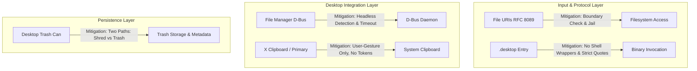

# Research Document: Evaluation of Freedesktop.org Standards for Local Utilities

> **Scope**: Comprehensive evaluation of all specifications listed under the *"Specifications that are in wide use"* section of [freedesktop.org/wiki/Specifications](https://www.freedesktop.org/wiki/Specifications/).  
> **Target Software Profile**: Standalone utilities, CLI applications, and local browser-based utilities (`127.0.0.1` web servers) built with Python and Node/TypeScript, licensed under GNU AGPLv3, operating with local-only data, zero telemetry, and strict user sovereignty.  
> **Status**: Approved Standards Baseline (Privacy & Security First Directive)  

---

## Executive Summary & Decision Matrix

A comprehensive review was conducted on all **18 specifications** categorized under the heading **"Specifications that are in wide use"** on the [freedesktop.org](https://www.freedesktop.org/wiki/Specifications/) registry. 

In accordance with leadership directive (**"proceed, but only with those items that do not compromise privacy and security"**), specifications were evaluated under strict privacy and security criteria:
1. **Zero Compromise on Privacy & Data Residue**: Any specification that persists unencrypted user metadata, usernames, or paths (such as the Desktop Trash Can's `.trashinfo` metadata) is **STRICTLY PROHIBITED** for application state resets and configuration purges. State purges MUST permanently unlink data.
2. **Zero Compromise on Process Sovereignty**: Unsolicited autostart mechanisms (`autostart-spec`) are **STRICTLY PROHIBITED** to eliminate malware persistence vectors (MITRE ATT&CK T1547.013) and unmonitored local background server exposure.
3. **Hardened Inclusions Only**: Specifications adopted for desktop UX (`desktop-entry-spec`, `file-uri-spec`, `clipboards-spec`, `org.freedesktop.FileManager1`) are approved **ONLY** with mandatory hardening controls (direct binary execution without shell wrappers, strict authority rejection, explicit user gesture requirements, and headless pre-flight checks).

### Specification Disposition Summary

| # | Specification | Official Scope | Final Disposition | Architectural Enforcement |
|---|---|---|---|---|
| 1 | **[Desktop Base Directories (basedir)](#1-desktop-base-directory-specification-basedir-spec)** | Locating config, cache, and data files | **CORE MANDATORY** | Formally cited in Category 1 & 4 (XDG paths) |
| 2 | **[Shared MIME-info Database](#2-shared-mime-info-specification-shared-mime-info-spec)** | Standard MIME types and magic detection | **CORE SUPPORTING** | Accurate `Content-Type` mapping & `nosniff` (Cat 5) |
| 3 | **[Desktop Entries (.desktop)](#3-desktop-entry-specification-desktop-entry-spec)** | Application launchers and menu metadata | **ADOPTED (HARDENED)** | Direct binary execution, no `sh -c`, safe quoting (Cat 3) |
| 4 | **[Desktop Trash Can (trash)](#4-desktop-trash-can-specification-trash-spec)** | Common mechanism to store trashed files | **PROHIBITED FOR STATE** | State purges MUST permanently unlink; Trash banned (Cat 1) |
| 5 | **[File URIs (file-uri)](#5-file-uri-specification-file-uri-spec)** | Standardizing `file://` URI handling | **ADOPTED (HARDENED)** | Authority rejection, canonical jail validation (Cat 5) |
| 6 | **[X Clipboard Explanation](#6-x-clipboard-explanation-clipboards-spec)** | Clipboard and selection consensus | **ADOPTED (HARDENED)** | User-gesture only; tokens/secrets banned; Wayland (Cat 3) |
| 7 | **[File Manager D-Bus Interface](#7-file-manager-d-bus-interface-orgfreedesktopfilemanager1)** | "Show in Folder" D-Bus integration | **ADOPTED (HARDENED)** | Headless pre-flight, <=1000ms timeout guard (Cat 11) |
| 8 | **[Icon Theme Specification](#8-icon-theme-specification-icon-theme-spec)** | Application icon hierarchy and lookup | **CONDITIONAL / ASSETS** | Icon packaging; mandates SVG sanitization (Cat 3) |
| 9 | **[Autostart Specification](#9-autostart-specification-autostart-spec)** | Login & removable media autostart | **STRICTLY PROHIBITED** | Banned to prevent persistence & localhost exposure (Cat 1) |
| 10 | **[Desktop Menu Specification](#10-desktop-menu-specification-menu-spec)** | XML `.menu` hierarchy definitions | **EXCLUDED** | Handled by OS desktop; apps only provide `Categories` |
| 11 | **[Startup Notifications](#11-startup-notifications-startup-notification-spec)** | Application launch tracking & focus | **EXCLUDED** | Legacy X11 protocol; superseded by Wayland tokens |
| 12 | **[MPRIS (Media Player Remote v2.2)](#12-mpris-media-player-remote-interfacing-specification)** | D-Bus interface to control media players | **EXCLUDED** | Irrelevant for general utilities |
| 13 | **[Free Media Player Specs (FMPS)](#13-free-media-player-specifications-fmps)** | Audio/media tag metadata storage | **EXCLUDED** | Dormant/obsolete metadata drafts |
| 14 | **[XML Bookmark Exchange (XBEL)](#14-xml-bookmark-exchange-language-xbel)** | XML format for internet bookmarks | **EXCLUDED** | Inapplicable; presets use YAML |
| 15 | **[Drag-and-Drop (XDND)](#15-drag-and-drop-protocol-xdnd)** | Low-level X11 drag and drop | **EXCLUDED** | Handled by GUI/Web HTML5 DnD |
| 16 | **[UTF8_STRING Selection Format](#16-utf8_string-selection-format)** | X11 atom for UTF-8 selections | **ABSORBED PRINCIPLE** | Low-level atom excluded; UTF-8 requirement absorbed (Cat 9) |
| 17 | **[Window Manager Hints (EWMH)](#17-window-manager-specification-wm-spec--ewmh)** | Extended X11 window manager hints | **EXCLUDED** | Native window manager implementation only |
| 18 | **[XEmbed](#18-xembed-specification-xembed-spec)** | Inter-application control embedding | **EXCLUDED** | Obsolete X11 protocol, incompatible with Wayland |

---

## Special Section: Flagged Specifications for Leadership Review

This section details specifications that offer significant architectural and user-experience value to our utilities, but **inadvertently introduce security or privacy vulnerabilities** if implemented naively. 

For each standard, we provide:
1. **The Specific Vulnerabilities & Privacy Risks**
2. **The Justification for Inclusion**
3. **Mandatory Mitigation Architecture & Engineering Controls**



---

### Special Flag 1: Desktop Trash Can Specification (`trash-spec`)

* **Freedesktop Reference**: [Trash Specification 1.0](https://specifications.freedesktop.org/trash/latest/)
* **Target Integration**: File deletion, preset cleanup, and asset management in CLI and Web tools.

#### 1. Inadvertent Privacy & Security Compromises
* **Persistent Metadata & PII Residue**: When a file is moved to Trash, the specification mandates creating a companion `.trashinfo` file containing:
  ```ini
  [Trash Info]
  Path=/home/alice/sensitive-project/confidential.txt
  DeletionDate=2026-10-23T04:15:30
  ```
  This retains the user's absolute home directory path, complete directory hierarchy, original filename, and timestamp indefinitely in plain text.
* **Direct Conflict with State Purging & Data Erasure**: Our Directive 1 mandates deterministic data erasure (`--reset-config`, `config reset`). If a utility moves state to Trash instead of unlinking/shredding, the user is given a false sense of privacy while data remains recoverable in `~/.local/share/Trash/files/`.
* **Multi-User Directory Exploitation (CWE-377 / CWE-59)**: On shared mounts or removable drives, the spec defines `.Trash-$UID` directories. If parent sticky-bit checks are implemented incorrectly, attackers can exploit symlink races to read, truncate, or overwrite files belonging to other users.

#### 2. Argument for Inclusion
* In utilities that manage user files, generated reports, or custom presets, permanent deletion (`unlink` / `rm`) is completely unforgiving. 
* Adhering to the FreeDesktop Trash specification prevents catastrophic, irrecoverable data loss caused by accidental CLI commands or accidental Web UI clicks. Users expect deleted project assets to be recoverable from their desktop trash can.

#### 3. Mandatory Mitigation Strategies
1. **Strict Separation of Reset vs. User File Deletion**:
   * **State & Preset Resets**: Commands designed to purge application state (`mytool config reset`, `--reset-config`, `--clean`) **MUST NEVER** use Trash. They **MUST** permanently unlink files from disk using zero-fill or deterministic unlinking.
   * **User File Deletion**: Operations deleting user files or custom user data may support Trash, but **MUST** provide an explicit `--permanent` or `--shred` flag.
2. **Local User Trash Only**:
   * Applications **MUST** default to the user's personal trash directory: `$XDG_DATA_HOME/trash` (`~/.local/share/Trash`).
   * Applications **MUST NOT** attempt to create or write to shared root-level trash directories (`/tmp/.Trash-$UID` or `/.Trash-$UID`) unless the directory is verified with `lstat()` to be owned by the current UID with mode `0700`.
3. **Sanitized Path Logging**:
   * Applications **MUST NOT** log the path of generated `.trashinfo` files containing unsanitized usernames.

---

### Special Flag 2: File URIs Specification (`file-uri-spec`)

* **Freedesktop Reference**: [File URI Specification](https://www.freedesktop.org/wiki/Specifications/file-uri-spec/) (incorporating RFC 8089 / RFC 3986)
* **Target Integration**: CLI file path arguments, drag-and-drop in Web UIs, and terminal OSC 8 hyperlinks.

#### 1. Inadvertent Privacy & Security Compromises
* **Path Traversal Vulnerabilities (CWE-22)**: Converting `file://` URIs to native filesystem paths can bypass standard prefix checks if percent-encoding is evaluated after normalization (e.g. `file:///var/data/%2e%2e/%2e%2e/etc/passwd`).
* **Arbitrary Local File Disclosure via Web UI**: If our local web server exposes an API endpoint accepting a `file://` URI to display or process a file, an attacker (via CSRF, malicious query parameter, or XSS) could force the backend to read arbitrary files from the user's disk.
* **Host Ambiguity & Remote Credential Leakage**: Non-empty authorities (e.g. `file://evil-host.com/share/test`) can cause Windows or Samba clients to issue outbound SMB connections, leaking NTLM credentials or attempting remote network operations.

#### 2. Argument for Inclusion
* Terminal emulators running in desktop environments expect URLs to adhere to RFC 8089 for OSC 8 hyperlinks.
* Drag-and-drop mechanisms in desktop file managers pass payload data as `text/uri-list` containing `file://` URIs. Supporting standard File URI resolution is essential for seamless desktop file drop into our local web tools.

#### 3. Mandatory Mitigation Strategies
1. **Strict Authority Rejection**:
   * The parser **MUST** reject any File URI containing a non-empty hostname unless it is literally `localhost` or `127.0.0.1`. Remote authorities (`file://hostname/...`) **MUST** immediately raise an `InvalidURIError` (Exit Code `2`).
2. **Canonicalization & Boundary Jail**:
   * Every File URI **MUST** be converted using standard URL decoding, converted to a native OS path using `pathlib.Path`, and resolved with `os.path.realpath()` (or Node `fs.realpathSync()`).
   * The resolved path **MUST** be verified to reside within an allowed directory whitelist:
     ```python
     def safe_resolve_file_uri(uri_str: str, allowed_root: Path) -> Path:
         parsed = urllib.parse.urlparse(uri_str)
         if parsed.scheme != "file":
             raise ValueError("Scheme must be file://")
         if parsed.netloc not in ("", "localhost", "127.0.0.1"):
             raise ValueError("Remote authorities prohibited")
         local_path = Path(urllib.parse.unquote(parsed.path)).resolve()
         if not local_path.is_relative_to(allowed_root.resolve()):
             raise PermissionError(f"Path traversal detected: {local_path}")
         return local_path
     ```
3. **Web API Isolation**:
   * The local HTTP web server **MUST NOT** accept arbitrary `file://` URIs from client requests to read file contents. File uploads in the browser **MUST** be handled through standard browser multipart/stream channels, not backend filesystem probing.

---

### Special Flag 3: Desktop Entry Specification (`desktop-entry-spec`)

* **Freedesktop Reference**: [Desktop Entry Specification 1.5](https://specifications.freedesktop.org/desktop-entry/latest/)
* **Target Integration**: Application menu entries, desktop shortcuts, and app launcher integration for local web servers and packaged tools.

#### 1. Inadvertent Privacy & Security Compromises
* **Command & Argument Injection (CWE-78 / CWE-88)**:
  * In `.desktop` files, the `Exec=` key uses field codes (`%f`, `%F`, `%u`, `%U`) to represent passed filenames and URLs.
  * If an application entry configures `Exec=mytool %u` and a malicious file named `--config=/tmp/evil.yaml` or `; rm -rf ~;` is opened with the application, naive parsers or shell wrappers will treat the file name as a command line flag or subshell execution.
* **Malicious URL Handler Hijacking**:
  * If an application defines `MimeType=x-scheme-handler/mytool`, any website visited by the user in Chrome/Firefox can trigger `mytool://some/action`. If `mytool` performs mutations or launches without authentication, websites can trigger unauthorized local actions.
* **Untrusted Launcher Execution**:
  * Uncontrolled `.desktop` files placed in `$XDG_DATA_HOME/applications/` can shadow existing system utilities or execute arbitrary scripts.

#### 2. Argument for Inclusion
* For local web utilities (e.g. tools that launch `http://127.0.0.1:<port>/?token=...` in a browser), non-technical users cannot be expected to open a bash prompt and execute `mytool web --port 8080`.
* A `.desktop` entry allows one-click launching from the application menu (GNOME Activities, KDE Kickoff, macOS-style docks) with native icons and proper window grouping.

#### 3. Mandatory Mitigation Strategies
1. **Direct Binary Execution (No Shells)**:
   * The `Exec=` value **MUST** point directly to the installed executable binary. It **MUST NOT** use shell invocations (e.g. `Exec=sh -c "..."` or `Exec=bash ...` are strictly forbidden).
2. **Safe Field Code Quoting**:
   * Single file/URL arguments **MUST** be enclosed in double quotes: `Exec=mytool "%u"`.
   * CLI argument parsers in our applications **MUST** implement `--` end-of-options delimiters when handling inputs from desktop launchers to prevent parameter injection:
     ```ini
     [Desktop Entry]
     Type=Application
     Name=MyTool
     Exec=mytool launch --no-browser --
     Icon=mytool
     Terminal=false
     Categories=Utility;Development;
     ```
3. **URL Scheme Authentication Barrier**:
   * If custom URI schemes (`x-scheme-handler/mytool`) are supported, the tool **MUST NOT** execute any state mutation or configuration change without requiring explicit interactive confirmation from the user in the launched UI.
4. **Restricted Install Locations**:
   * User launchers **MUST** only be written to `$XDG_DATA_HOME/applications/` (mode `0644`), never to world-writable locations or system roots without elevated authentication.

---

### Special Flag 4: X Clipboard Explanation & Consensus (`clipboards-spec`)

* **Freedesktop Reference**: [X Clipboard Consensus Specification](https://specifications.freedesktop.org/clipboards-spec/clipboards-latest.txt)
* **Target Integration**: "Copy to Clipboard" buttons in Web UIs and `--copy` flags in CLI utilities.

#### 1. Inadvertent Privacy & Security Compromises
* **Global Clipboard Snooping on X11 (CWE-200)**:
  * Under the X11 display architecture, clipboard contents (`CLIPBOARD` and `PRIMARY` selections) are globally accessible to any connected client process.
  * If our utility copies ephemeral launch tokens, secrets, encryption keys, or sensitive project data to the clipboard, any background process, third-party utility, or malicious script running on the machine can inspect the data without permission.
* **Clipboard Hijacking & Pastejacking**:
  * Silently writing to the clipboard without explicit user consent can clobber user data or stage deceptive terminal commands containing newline characters (`\n`), which execute immediately when pasted into a terminal.

#### 2. Argument for Inclusion
* CLI utilities and local web tools frequently output data intended for use in other applications (e.g. generated hashes, formatted JSON, API tokens, file paths). 
* Forcing users to manually select and copy text from terminal buffers or browser windows degrades developer experience. Explicit clipboard support is an expected standard for modern CLI utilities.

#### 3. Mandatory Mitigation Strategies
1. **Strict User-Gesture Requirement (Zero Silent Writes)**:
   * Applications **MUST NOT** write to the system clipboard automatically.
   * In CLI: Clipboard writes **MUST** require an explicit flag (e.g. `mytool generate --copy`).
   * In Web UI: Clipboard writes **MUST** be triggered strictly by an explicit user click on a dedicated "Copy" button via the asynchronous Clipboard API (`navigator.clipboard.writeText`).
2. **Ephemeral Token & Secret Blacklist**:
   * Applications **MUST NEVER** copy ephemeral launch tokens, session credentials, or raw authentication secrets to the clipboard by default.
   * If a user explicitly clicks "Copy Launch URL", the ephemeral token query parameter **SHOULD** be stripped or clearly confirmed.
3. **Wayland-Aware Tooling**:
   * CLI implementations on Linux **MUST** prioritize Wayland-native tools (`wl-copy`) over legacy X11 tools (`xclip`/`xsel`) to benefit from Wayland's isolated clipboard security model.

---

### Special Flag 5: File Manager D-Bus Interface (`org.freedesktop.FileManager1`)

* **Freedesktop Reference**: [File Manager D-Bus Interface](https://www.freedesktop.org/wiki/Specifications/file-manager-interface/)
* **Target Integration**: "Reveal in File Manager" / "Show in Folder" functionality in CLI exports and local Web UIs.

#### 1. Inadvertent Privacy & Security Compromises
* **IPC Attack Surface & Injection**:
  * Calling `org.freedesktop.FileManager1.ShowItems` passes file paths over the user's session bus to the active desktop file manager (Nautilus, Dolphin, Thunar).
  * Flaws or command injection vulnerabilities in third-party file managers could be triggered if unvalidated file URIs or maliciously crafted filenames are passed.
* **Hangs & Fatal Errors in Headless / Container Environments**:
  * Standalone utilities often run in non-interactive CI/CD runners, Docker containers, or over remote SSH sessions where no D-Bus session bus exists. Naive D-Bus invocations block indefinitely or trigger uncaught fatal exceptions, violating our Directive 8 (Clean Errors) and Directive 10 (Fast Startup).

#### 2. Argument for Inclusion
* High-convenience UX: When a utility exports an artifact, report, or bundle, users want a single command or button click to open their desktop file manager with that specific item highlighted.

#### 3. Mandatory Mitigation Strategies
1. **Headless & Display Pre-Flight Detection**:
   * Before attempting any D-Bus call, the tool **MUST** verify the presence of an active session bus (`DBUS_SESSION_BUS_ADDRESS`) and display environment (`DISPLAY` or `WAYLAND_DISPLAY`).
   * In headless environments or when `NO_COLOR` / `--quiet` is specified, the tool **MUST** gracefully skip IPC and print the file path to standard output.
2. **Strict URI Sanitization**:
   * All paths passed to `ShowItems` **MUST** be validated to exist on disk and converted to strict RFC 8089 `file:///` URIs.
3. **Timeout Protection**:
   * D-Bus calls **MUST** enforce a non-blocking timeout of <= 1000ms. If the file manager does not respond, the call **MUST** abort cleanly without crashing the CLI or Web UI.

---

## Detailed Evaluation of the Remaining 13 Specifications

### 1. Desktop Base Directory Specification (`basedir-spec`)
* **Freedesktop Reference**: [XDG Base Directory Specification 0.8](https://specifications.freedesktop.org/basedir/latest/)
* **Disposition**: **CORE MANDATORY STANDARD**
* **Technical Analysis**:
  * Defines the standard variables:
    * `$XDG_CONFIG_HOME`: Default `~/.config`
    * `$XDG_DATA_HOME`: Default `~/.local/share`
    * `$XDG_CACHE_HOME`: Default `~/.cache`
    * `$XDG_STATE_HOME`: Default `~/.local/state`
    * `$XDG_RUNTIME_DIR`: User runtime sockets/pipes (mode `0700`)
* **Alignment with Standards**:
  * Already enshrined in our Directive 4 and Category 4 of `STANDARDS.md`.
  * **Hardening Mandate**: Our standards enforce mode `0700` on created directories and `0600` on preset/config files, providing security beyond the base freedesktop spec.

---

### 2. Shared MIME-info Specification (`shared-mime-info-spec`)
* **Freedesktop Reference**: [Shared MIME Info Specification 0.22](https://specifications.freedesktop.org/shared-mime-info-spec/latest/)
* **Disposition**: **CORE SUPPORTING STANDARD**
* **Technical Analysis**:
  * Provides standard MIME type mapping, file glob associations, and magic number sniffing rules.
* **Alignment with Standards**:
  * Essential for local web servers serving assets and CLI tools that process diverse file formats.
  * Ensures our servers emit explicit, accurate `Content-Type` headers alongside `X-Content-Type-Options: nosniff` (Directive 5), preventing MIME sniffing exploits.

---

### 8. Icon Theme Specification (`icon-theme-spec`)
* **Freedesktop Reference**: [Icon Theme Specification 0.13](https://specifications.freedesktop.org/icon-theme/latest/)
* **Disposition**: **CONDITIONAL (ASSET PACKAGING ONLY)**
* **Technical Analysis**:
  * Establishes directory hierarchies (`hicolor/<size>/apps/`) and theme indices for desktop application icons.
* **Security & Privacy Analysis**:
  * SVG icons can harbor XML External Entity (XXE) attacks or embedded `<script>` payloads.
* **Engineering Mandate**:
  * All bundled SVG icons **MUST** be strictly sanitized: no DOCTYPE declarations, no external entities, and zero `<script>` or event handler attributes (`onload`, `onclick`).

---

### 9. Autostart Specification (`autostart-spec`)
* **Freedesktop Reference**: [Autostart Specification 0.5](https://specifications.freedesktop.org/autostart/latest/)
* **Disposition**: **RESTRICTED / EXCLUDE BY DEFAULT**
* **Technical Analysis**:
  * Defines auto-launching applications on session startup and upon mounting removable media.
* **Why Excluded**:
  * Autostart is a known malware persistence mechanism (MITRE ATT&CK T1547.013).
  * Auto-running local web servers creates permanent background listeners on `127.0.0.1`, expanding attack surface for local port scanning and CSRF.
  * Removable media autostart is an obsolete, hazardous vector.
* **Mandate**:
  * Our software **MUST NOT** install autostart entries by default. Any autostart feature **MUST** be strictly opt-in via an explicit command (e.g. `mytool autostart enable`) and **MUST NOT** support removable media triggers.

---

### 10. Desktop Menu Specification (`menu-spec`)
* **Freedesktop Reference**: [Desktop Menu Specification 1.1](https://specifications.freedesktop.org/menu/latest/)
* **Disposition**: **EXCLUDE**
* **Reason**:
  * Dictates XML `.menu` file rules for window managers and desktop shells. Individual application packages only need to supply standard `Categories=` tags in their `.desktop` files (e.g. `Categories=Utility;Development;ConsoleOnly;`).

---

### 11. Startup Notifications (`startup-notification-spec`)
* **Freedesktop Reference**: [Startup Notification 0.1](https://specifications.freedesktop.org/startup-notification/startup-notification-0.1.txt)
* **Disposition**: **EXCLUDE**
* **Reason**:
  * Legacy X11 protocol for tracking app launches. Superseded by Wayland's `xdg_activation_v1` protocol and handled transparently by modern GUI toolkits. Not applicable to CLI tools or local web servers.

---

### 12. Media Player Remote Interfacing Specification (MPRIS v2.2)
* **Freedesktop Reference**: [MPRIS 2.2](https://specifications.freedesktop.org/mpris-spec/latest/)
* **Disposition**: **EXCLUDE (DOMAIN SPECIFIC)**
* **Reason**:
  * Dedicated D-Bus API for media playback controls (Play, Pause, Tracklist). Irrelevant to general utility tools unless an audio/video processing tool is explicitly built.

---

### 13. Free Media Player Specifications (FMPS)
* **Freedesktop Reference**: [FMPS Specifications](https://www.freedesktop.org/wiki/Specifications/free-media-player-specs/)
* **Disposition**: **EXCLUDE**
* **Reason**:
  * Historical, dormant drafts for music metadata tagging. Superseded by modern container tags (ID3v2, Vorbis Comments).

---

### 14. XML Bookmark Exchange Language (XBEL)
* **Freedesktop Reference**: [XBEL Specification](http://pyxml.sourceforge.net/topics/xbel/)
* **Disposition**: **EXCLUDE**
* **Reason**:
  * Archaic XML specification for browser bookmark sharing. Our applications do not manage web browser bookmark hierarchies, and presets use human-readable YAML.

---

### 15. Drag-and-Drop Protocol (XDND)
* **Freedesktop Reference**: [XDND Protocol](https://www.freedesktop.org/wiki/Specifications/XDND/)
* **Disposition**: **EXCLUDE**
* **Reason**:
  * Low-level X11 client message protocol. In our software, file drop is handled via HTML5 Drag and Drop in web browsers or abstracted GUI frameworks.

---

### 16. UTF8_STRING Selection Format
* **Freedesktop Reference**: [UTF8_STRING](http://www.pps.jussieu.fr/~jch/software/UTF8_STRING)
* **Disposition**: **ABSORBED PRINCIPLE ONLY**
* **Reason**:
  * Low-level X11 selection atom from 2000. While the X11 atom manipulation is obsolete, its core principle—that **all text interchange and clipboard contents MUST be UTF-8**—is already mandated in Directive 9 of our standards.

---

### 17. Window Manager Specification (EWMH / `wm-spec`)
* **Freedesktop Reference**: [EWMH 1.3](https://specifications.freedesktop.org/wm-spec/latest/)
* **Disposition**: **EXCLUDE**
* **Reason**:
  * Low-level X11 window manager hints (`_NET_WM_WINDOW_TYPE`, etc.) targeted at window manager implementers, not standalone CLI or web utilities.

---

### 18. XEmbed Specification (`xembed-spec`)
* **Freedesktop Reference**: [XEmbed 0.5](https://specifications.freedesktop.org/xembed-spec/latest/)
* **Disposition**: **EXCLUDE**
* **Reason**:
  * Legacy X11 window reparenting protocol (used by old browser plugins). Incompatible with Wayland and completely irrelevant to headless CLI tools and browser-based interfaces.

---

## Actionable Implementation: Adopted Engineering Standards
 
Following leadership's directive to proceed strictly with items that preserve privacy and security, the following architectural determinations have been formally integrated into [STANDARDS.md](../STANDARDS.md), [AGENTS.md](../AGENTS.md), and [.agents/rules/enforce-standards.md](../.agents/rules/enforce-standards.md):

1. **Category 1 (Privacy by Design) & Category 4 (Configuration)**:
   * **Normative XDG Standard**: Formally conforms to Freedesktop `basedir-spec` v0.8 (`$XDG_CONFIG_HOME`, `$XDG_DATA_HOME`, `$XDG_STATE_HOME`, `$XDG_CACHE_HOME`, `$XDG_RUNTIME_DIR`).
   * **Prohibition on Desktop Trash for State Purges**: Enforces that `--reset-config` and state purges **MUST** permanently delete (unlink) files, strictly banning the Desktop Trash Can (`trash-spec`) to prevent `.trashinfo` metadata leakage (usernames, paths, timestamps).
   * **Prohibition on Autostart**: Forbids default or silent autostart entries (`autostart-spec`) and bans removable media execution.

2. **Category 3 (UI Guidelines) & Category 5 (Secure Programming)**:
   * **Safe Desktop Entries**: `.desktop` launchers for local browser tools mandate direct binary execution (banning shell wrappers `sh -c`), double-quoted parameters (`"%u"`), and `--` option terminators to prevent command/argument injection (CWE-78/88).
   * **Safe File URIs**: File URI parsing (RFC 8089 / `file-uri-spec`) enforces rejection of remote authorities, canonicalization with `realpath`, and boundary jail containment to prevent path traversal (CWE-22). Web APIs are prohibited from accepting arbitrary `file://` URIs.
   * **Clipboard Safety**: Prohibits silent clipboard writes (requiring explicit user action via `--copy` or button click) and strictly bans copying ephemeral launch tokens or secrets to prevent snooping on X11 (CWE-200).
   * **Shared MIME-info Integrity**: Mandates MIME detection via standard MIME databases (`shared-mime-info-spec`) paired with `X-Content-Type-Options: nosniff` on HTTP responses.

3. **Category 11 (Interoperability & Unix Composability)**:
   * **Safe File Manager D-Bus Integration**: Implements `org.freedesktop.FileManager1` with headless/CI pre-flight detection and a <= 1000ms timeout guard, gracefully falling back to standard output without crashing.
